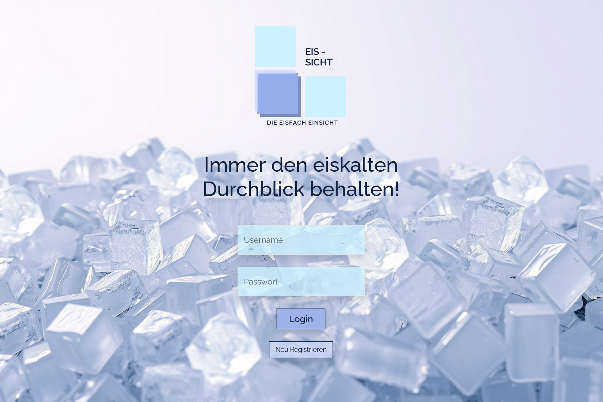
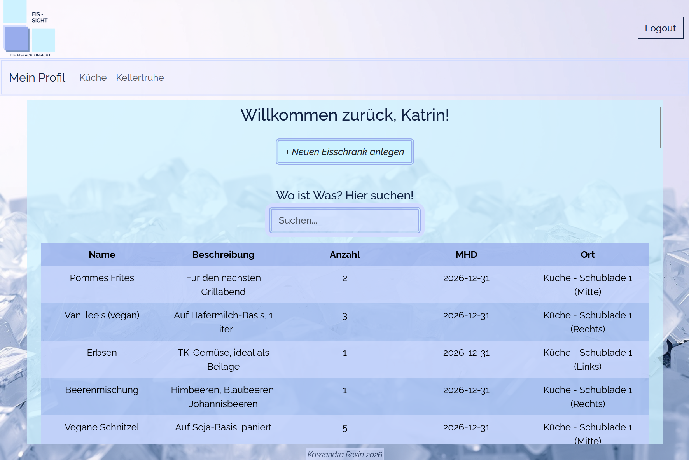
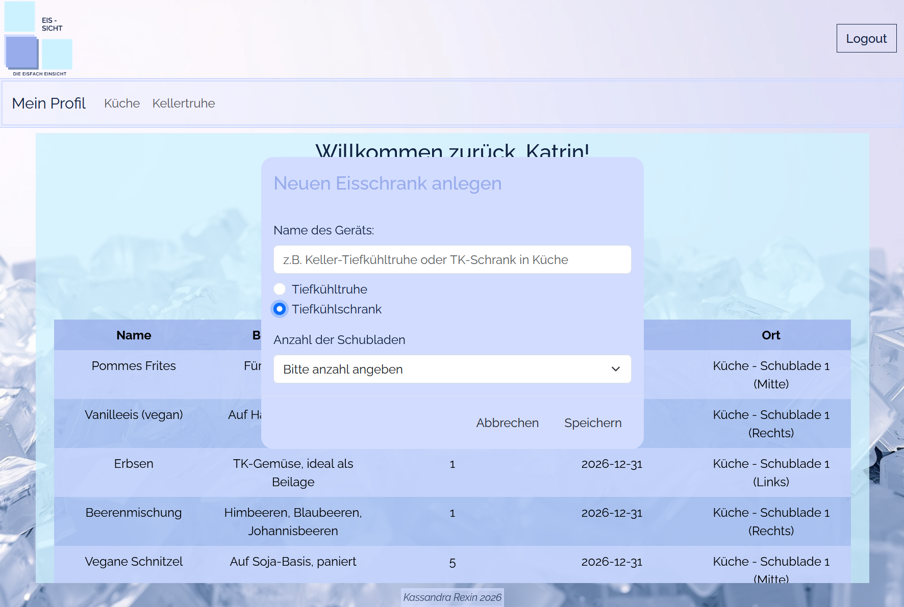
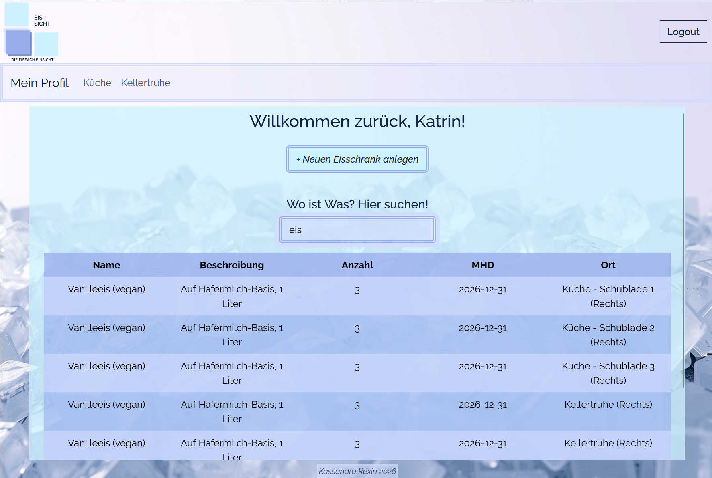
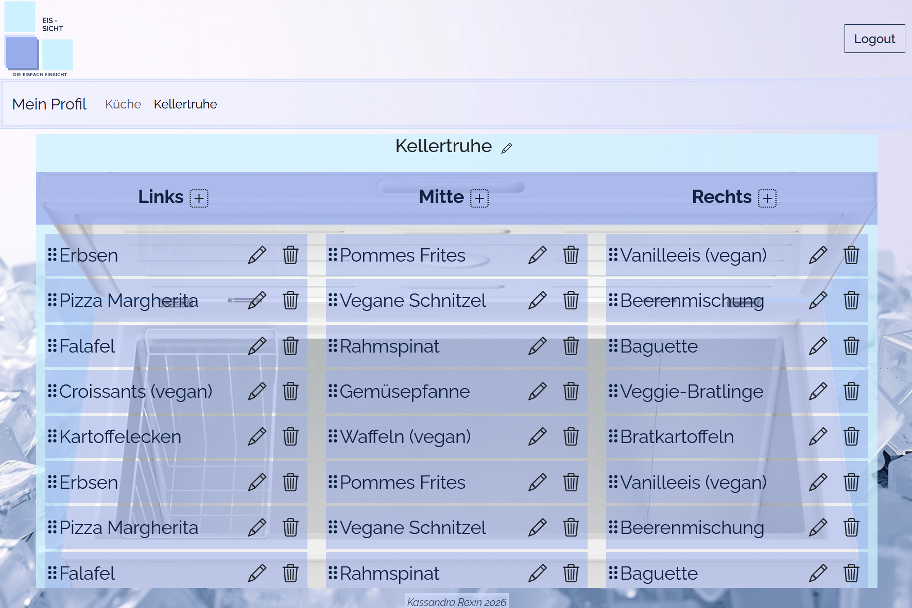
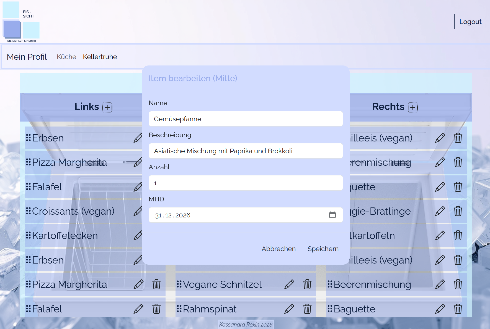

# 🧊 EisSicht

**Immer den eiskalten Durchblick behalten!**

EisSicht ist eine Webanwendung zur Verwaltung von Tiefkühlinhalten (Tiefkühltruhen und -schränke). Nach dem Login sieht jede Nutzerin ausschließlich ihre eigenen Geräte: Über die Navbar lassen sich beliebig viele **Tiefkühltruhen** oder **Tiefkühlschränke** (mit frei wählbarer Schubladenanzahl) anlegen. Jedes Gerät bzw. jede Schublade besitzt eine Tabelle mit drei Positionen (**links / mitte / rechts**), in denen Items per Drag & Drop organisiert werden – inklusive Name, Beschreibung, Anzahl und Mindesthaltbarkeitsdatum. Auf der Profil-Startseite gibt es zusätzlich eine durchsuchbare Gesamtübersicht aller Items.

Dieses Projekt ist im Rahmen der Vorlesung **Web Technologien** an der HTW Berlin entstanden.

---

## Inhaltsverzeichnis

- [Features](#features)
- [Screenshots](#screenshots)
- [Verwendete Technologien](#verwendete-technologien)
- [Installation](#installation)
- [Testzugänge](#testzugänge)
- [Projektstruktur](#projektstruktur)
- [Verwendete KI-Werkzeuge](#verwendete-ki-werkzeuge)
- [Weitere Quellen](#weitere-quellen)

---

## Features

- 🔐 Registrierung & Login mit Passwort-Hashing (bcrypt) und Token-Authentifizierung (JWT)
- 🧊 Neue Geräte (Tiefkühltruhe oder -schrank mit frei wählbarer Schubladenanzahl) anlegen, umbenennen und löschen
- 📦 Items pro Gerät/Schublade anlegen, bearbeiten und löschen
- 🖱️ Umsortieren und Verschieben der Items per Drag & Drop (Angular CDK) – Reihenfolge bleibt dauerhaft gespeichert
- 🔍 Gesamtübersicht mit Echtzeit-Suche über alle Items und Geräte hinweg
- 🔒 Jede Nutzerin sieht ausschließlich ihre eigenen Daten (serverseitig über Token abgesichert)
- 🎨 Responsives Design mit Bootstrap, das sich an die Fenstergröße anpasst
- 🌱 Datenbank kann per Skript automatisch mit Testdaten vorausgefüllt werden

---

## Screenshots

| Login | Profil-Übersicht |
|---|---|
|  |  |

| Gerät anlegen | Suchfunktion |
|---|---|
|  |  |

| Gerät mit Items | Item bearbeiten |
|---|---|
|  |  |

---

## Verwendete Technologien

**Frontend**
- Angular (Standalone Components, Signals, `@angular/forms/signals`)
- Angular CDK (`@angular/cdk/drag-drop`)
- Bootstrap 5 + Bootstrap Icons

**Backend**
- Node.js mit Express
- MongoDB Atlas (über Mongoose)
- JWT (`jsonwebtoken`) für die Authentifizierung
- `bcrypt` zum Hashen der Passwörter

---

## Installation

### Voraussetzungen

- [Git](https://git-scm.com/)
- [Node.js](https://nodejs.org/) (Version 20+)
- Angular CLI global installiert (`npm install -g @angular/cli`), damit der Befehl `ng` zur Verfügung steht
- Ein MongoDB-Atlas-Cluster (oder eine lokale MongoDB-Instanz)

### 1. Repositories klonen

```bash
git clone https://github.com/k-rexin/Webtech2026/tree/master/semesteraufgabe26
git clone https://github.com/k-rexin/Webtech2026/tree/master/backend-semesteraufgabe26
```

### 2. Backend einrichten

```bash
cd backend-semesteraufgabe26
npm install
```

Im Backend-Ordner eine Datei `.env` anlegen mit folgendem Inhalt:

```
DB_CONNECTION = <deine MongoDB-Connection-URL>
DATABASE = EisSicht
```

Backend starten:

```bash
node --watch server.js
```

Beim allerersten Start wird die Datenbank automatisch mit Testdaten befüllt (siehe [Testzugänge](#testzugänge)), sofern sie leer ist.


### 3. Frontend einrichten

```bash
cd semesteraufgabe26
npm install
ng serve
```

Die Anwendung ist danach unter `http://localhost:4200` erreichbar, das Backend läuft auf `http://localhost:3000`.

---

## Testzugänge

Nach dem ersten Start (bzw. nach Ausführen von `node seed.js`) stehen automatisch folgende Testkonten zur Verfügung:

| Username | Passwort | Inhalt |
|---|---|---|
| `kassandra` | `test1234` | Küchenschrank mit 2 Schubladen, 20 Items |
| `katrin` | `test1234` | Küchenschrank mit 3 Schubladen (30 Items) + Kellertruhe (40 Items) |
| `gast` | `test1234` | Kein Gerät angelegt (testet den leeren Zustand der Anwendung) |

Über den "Neu Registrieren"-Button auf der Login-Seite können zusätzlich eigene Konten angelegt werden.

---

## Projektstruktur

```
backend-semesteraufgabe26/
  models/       # Mongoose-Schemas (User, Geraet, Item)
  routes/       # Express-Routen (users, geraete, items)
  utils/        # Hilfsfunktionen (u.a. Token-Prüfung)
  seed-data.js  # Testdaten-Generierung
  seed.js       # Manuelles Reset-Skript
  server.js     # Einstiegspunkt

semesteraufgabe26/
  src/app/
    footer/         # Footer-Komponente
    header/         # Header-Komponente
    login/          # Login- und Registrierungs-Komponente
    nav/            # Navigationsleiste-Komponente
    profil/         # Profil-Layout
      geraete-component/       # Gerät-Layout
          geraete-table/            # Tabelle-Layout mit Drag & Drop Funktion
          item-modal/               # Modal zum Anlegen eines Items
      profil-home/             # Home-Layout mit Modal zum Anlegen eines Geräts
          profil-table/             # Item-Suchtabelle
    shared/         # Services (Auth, Geräte, Items) und authGuard
```

---

## Verwendete KI-Werkzeuge

**Image-Ai von Academiccloud**
- Generierung vom Hintergrundbild

**Figma**
- Erstellen vom ersten Modell für die interaktive Item-Tabelle

**Claude (Anthropic) FREE** 
- Konzeption der Datenbankstruktur (Collections `users`, `geraete`, `items` inkl. Beziehungen über `userId`/`geraetId`)
- Erklärung von Angular-Konzepten (Signals, `@angular/forms/signals`, Guards, `effect()`, `toSignal()`)
- Fehlersuche und Debugging
- Aufbau der Backend-Routen (CRUD, JWT-Authentifizierung, Zugriffsschutz pro Nutzerin)
- Erstellung des Seed-Skripts zur automatischen Testdaten-Generierung
- Responsive-Design-Anpassungen (u. a. `clamp()` für Schrift- und Elementgrößen)
- Formulierungshilfe / Strukturierung dieser README-Datei

---

## Weitere Quellen
 
- Zusammenstellung vom Farbschema:  https://schemecolor.com/
- Schriftart: https://fontsource.org/fonts/raleway
- Basis-Logo:  https://www.canva.com/ “Bunt Quadrate Vorschulerziehung Logo” 
- Logik & Verständnis : https://freiheit.f4.htw-berlin.de/webtech/
